# WutheringWavesBox

[](LICENSE)
[](https://github.com/aslingguang/WutheringWavesBox)

WutheringWavesBox（鸣潮工具箱）是面向 Windows 的第三方鸣潮桌面工具。集成游戏启动、多账号管理、本地抽卡分析、库街区数据、兑换码获取和界面个性化。

> 本项目与库洛游戏没有官方关联。账号、Token、抽卡记录和游戏配置都属于敏感数据，请只从可信来源获取构建产物。

- 项目主页：[github.com/aslingguang/WutheringWavesBox](https://github.com/aslingguang/WutheringWavesBox)
- 版本与安装包：[GitHub Releases](https://github.com/aslingguang/WutheringWavesBox/releases)
- 问题反馈：[GitHub Issues](https://github.com/aslingguang/WutheringWavesBox/issues)

## 界面预览

<table>
  <tr>
    <td align="center"><strong>主页</strong></td>
    <td align="center"><strong>兑换码</strong></td>
  </tr>
  <tr>
    <td>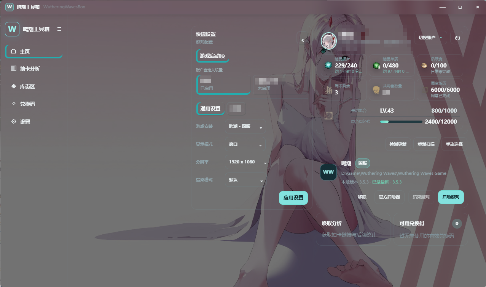</td>
    <td>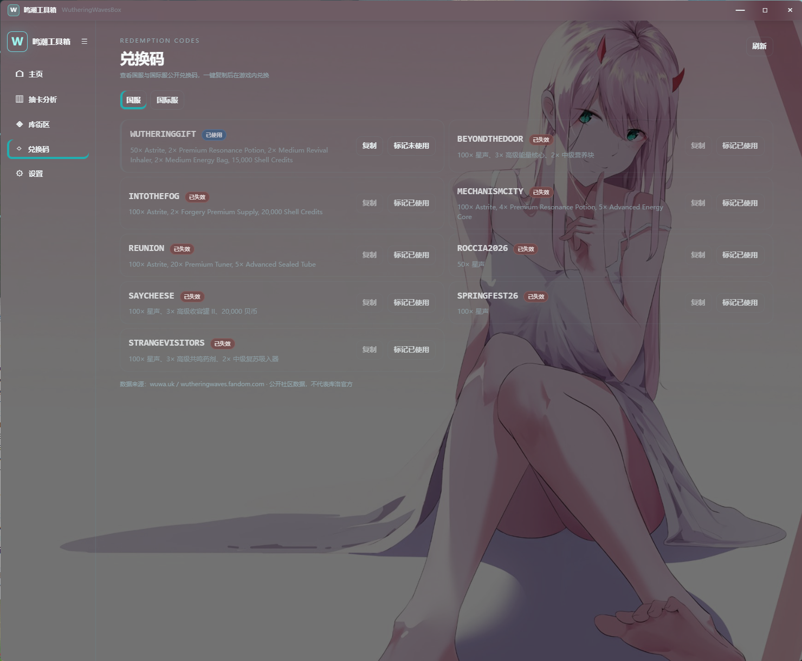</td>
  </tr>
  <tr>
    <td align="center"><strong>抽卡分析1</strong></td>
    <td align="center"><strong>抽卡分析2</strong></td>
  </tr>
  <tr>
    <td>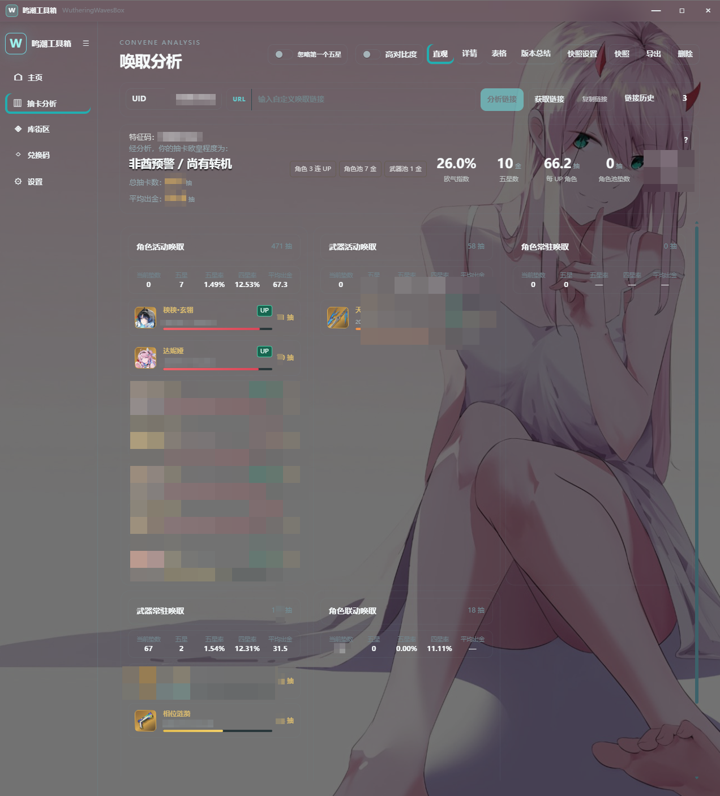</td>
    <td>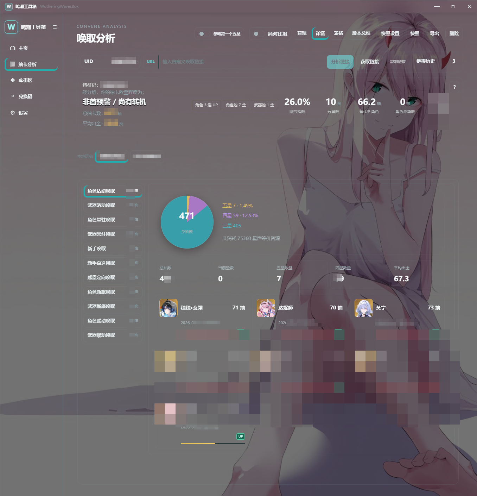</td>
  </tr>
  <tr>
    <td align="center"><strong>抽卡分析3</strong></td>
    <td align="center"><strong>抽卡分析4</strong></td>
  </tr>
  <tr>
    <td>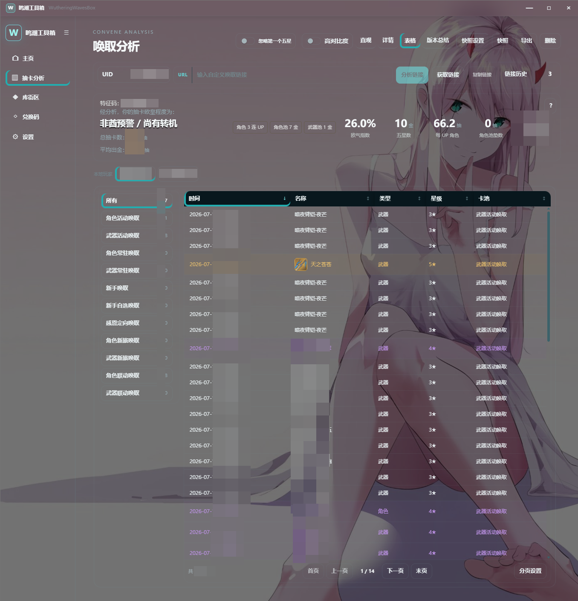</td>
    <td>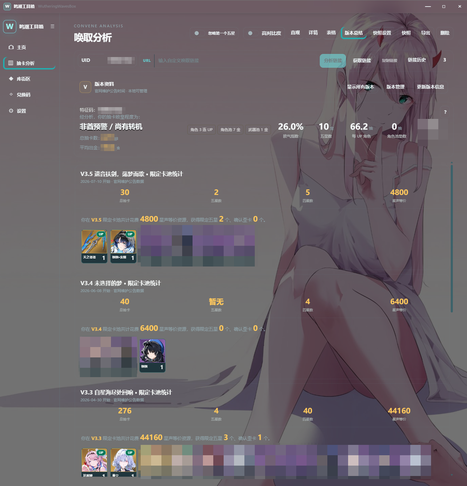</td>
  </tr>
  <tr>
    <td align="center"><strong>库街区每日签到</strong></td>
    <td align="center"><strong>库街区资源简报</strong></td>
  </tr>
  <tr>
    <td>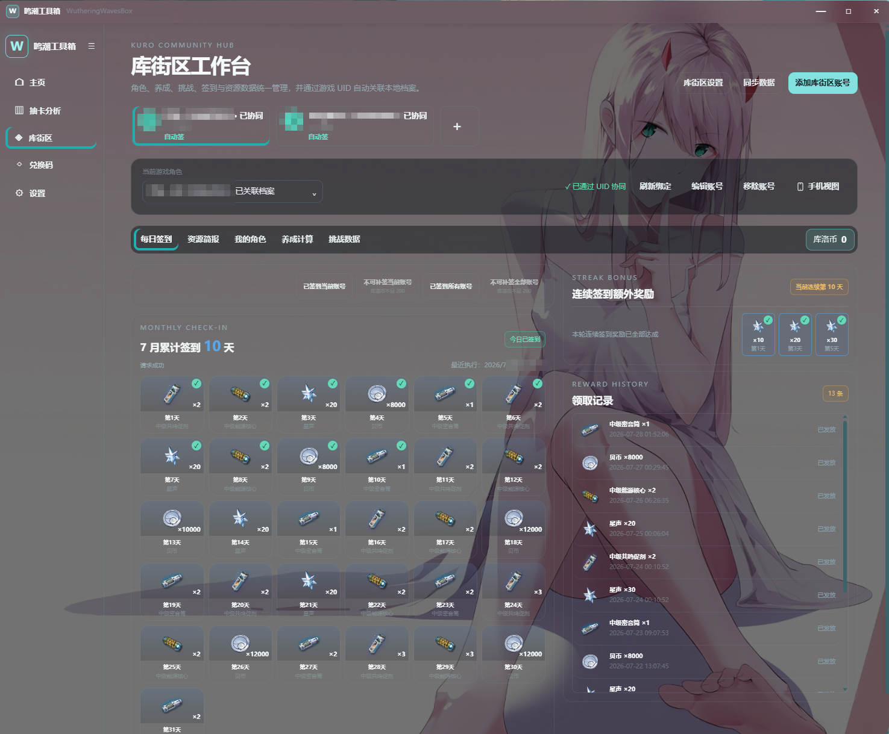</td>
    <td>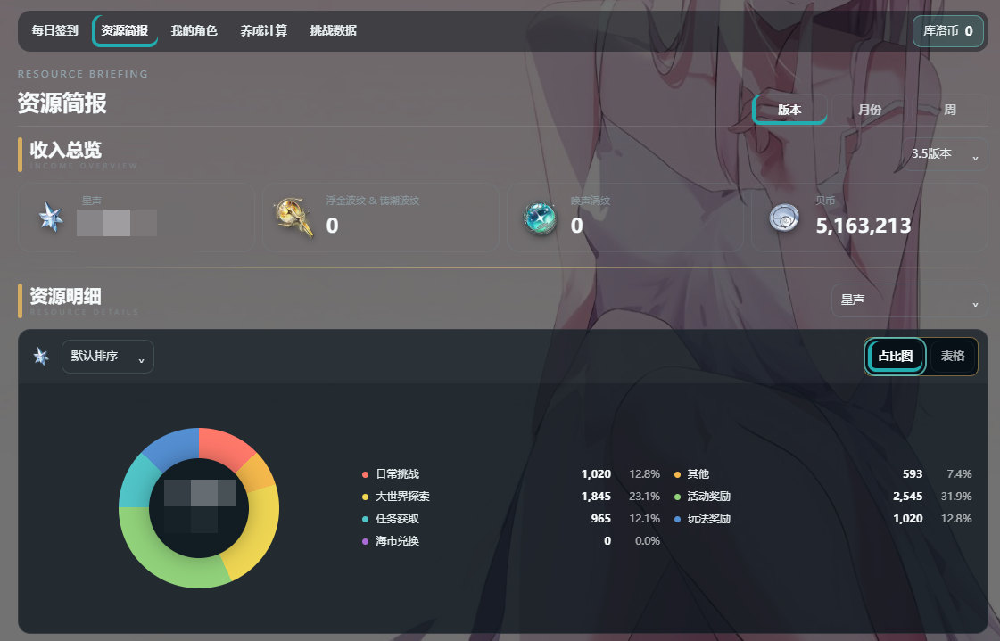</td>
  </tr>
  <tr>
    <td align="center"><strong>库街区我的角色列表</strong></td>
    <td align="center"><strong>库街区我的角色详情</strong></td>
  </tr>
  <tr>
    <td>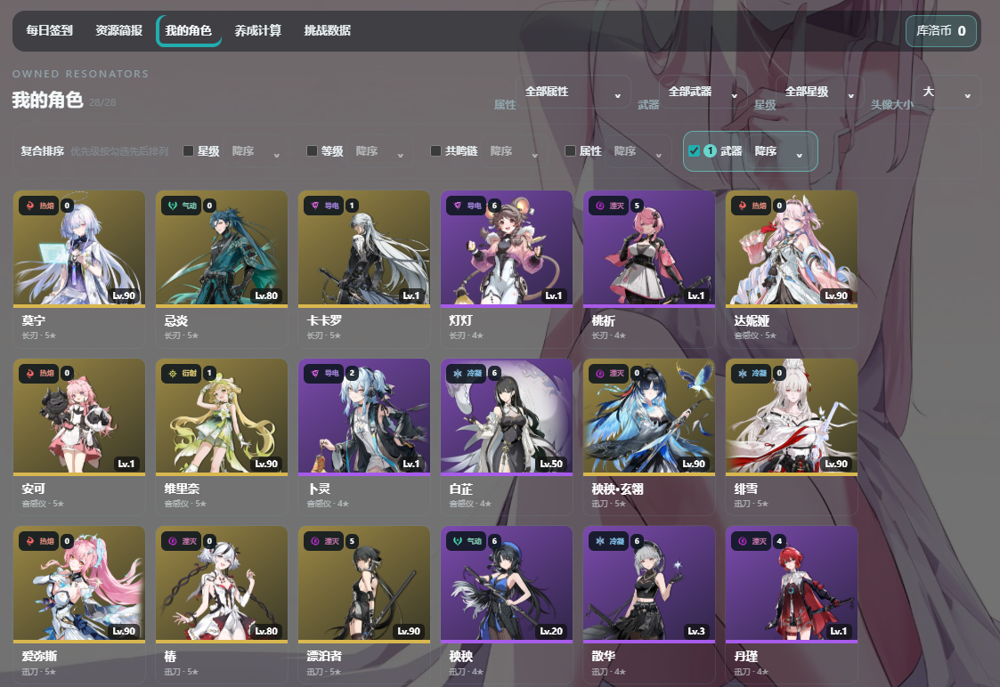</td>
    <td>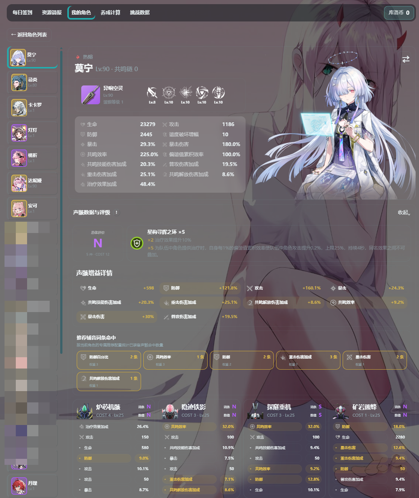</td>
  </tr>
  <tr>
    <td align="center"><strong>库街区养成计算角色列表</strong></td>
    <td align="center"><strong>库街区养成计算角色详情</strong></td>
  </tr>
  <tr>
    <td>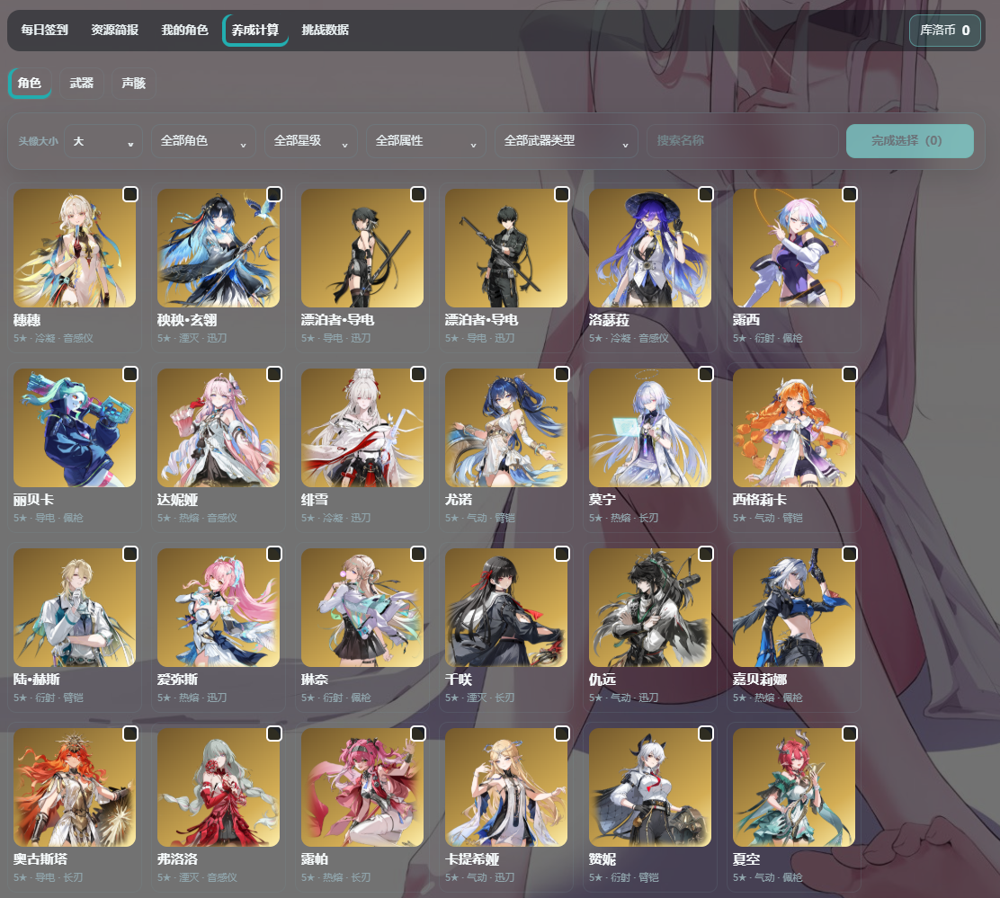</td>
    <td>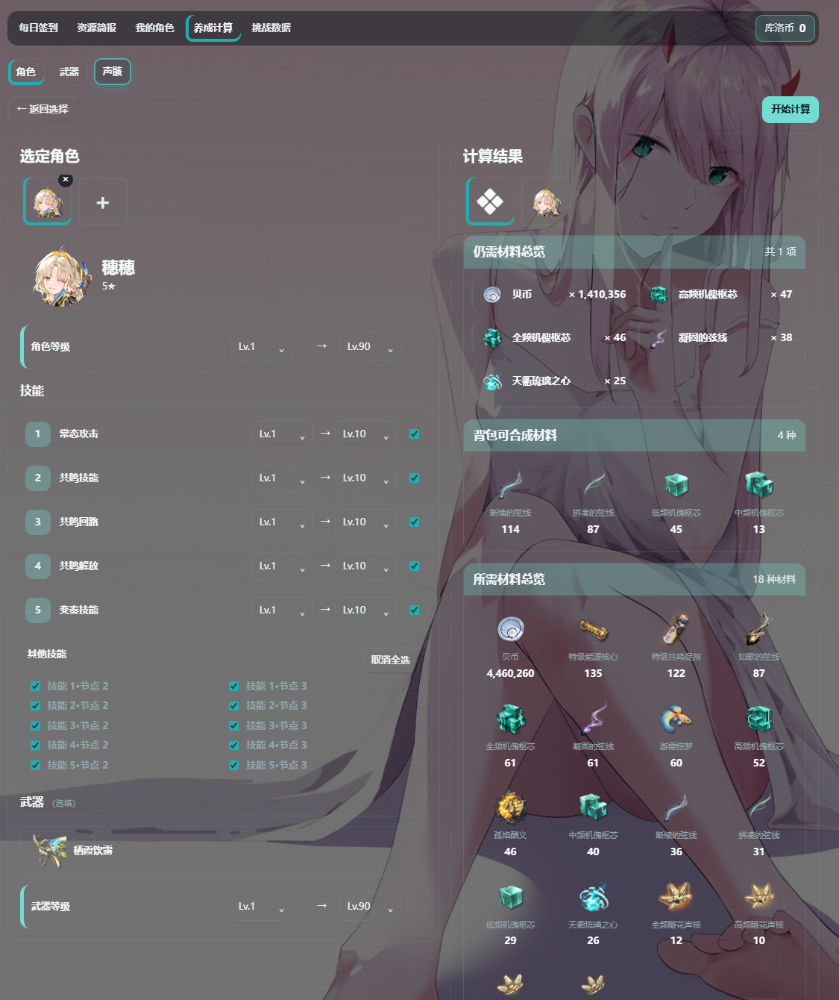</td>
  </tr>
</table>

## 主要功能

- **游戏管理**：自动扫描或手动添加国服、国际服及渠道服安装，读取本地版本，检查远端版本并调用官方启动器更新。
- **快捷启动**：多账号（可单独配置启动设置）快速切换启动。按通用模板或指定账号保存显示模式、分辨率和 DirectX 启动参数；启动前写入最终配置并监控游戏进程。
- **账号管理**：创建本地账号档案，读取官方启动器已登录账号，并切换已适配的国服游戏 SDK 登录缓存。
- **主页概览**：展示角色、UID、体力、活跃度、周本、战令、共鸣者数量和周度游历等信息。
- **抽卡分析**：从游戏日志发现抽卡链接，获取并按 UID 去重保存记录，提供直观、详情、表格和版本总结视图以及 PNG 快照。
- **库街区工作台**：管理库街区账号，执行签到和补签，查看资源简报、角色、挑战数据并使用养成计算器。
- **兑换码**：同步国服和国际服公开数据源，复制兑换码并保存已使用状态。
- **界面个性化**：提供玻璃、深色和浅色主题，支持壁纸、透明度、统一高亮与悬停样式。

部分功能依赖游戏、官方启动器、库街区或社区数据源。网络不可用或上游接口变化时，本地启动、已有档案和历史数据仍可使用，但在线信息可能暂时无法刷新。

## 技术路线

项目采用 npm Workspaces 管理的 Windows 桌面 Monorepo：

```text
Vue 3 Renderer
      │ 强类型 preload API
Electron Main ── SQLite / HTTP 服务 / 本地缓存
      │ JSON-RPC
.NET 10 Helper ── Windows API / 注册表 / 游戏文件与进程
```

- **Electron 43 + Vue 3 + TypeScript**：桌面窗口、交互界面和业务展示。
- **Vite / electron-vite**：Renderer、Preload 和 Main 的开发与生产构建。
- **Node.js 服务层**：SQLite 仓储、抽卡导入、版本检测、库街区和兑换码适配器。
- **.NET 10 Helper**：封装游戏目录探测、日志读取、进程控制等 Windows 原生能力。
- **共享契约**：`packages/contracts` 维护 Renderer、Main 和 Helper 边界使用的数据类型。
- **安全边界**：Renderer 不直接访问 Node.js、文件系统、注册表或任意 IPC；敏感能力只通过白名单接口暴露。

## 使用方法

### 使用构建产物

1. 在 Windows 10 22H2 或 Windows 11 上安装项目发布的 x64 安装包，或运行便携版。
2. 首次启动后在主页扫描游戏；未识别时使用“手动选择”定位游戏根目录。
3. 从官方启动器导入已登录账号，或在账号档案页创建只包含显示信息的本地档案。
4. 在“快捷设置 > 游戏启动项”选择安装、显示模式、分辨率和渲染模式，然后应用设置。
5. 使用安装卡启动游戏。抽卡分析、库街区和兑换码可从左侧导航进入。

应用不会替代官方游戏下载和文件修复流程。检测到游戏更新时会打开对应官方启动器。

### 本地开发

要求：

- Windows 10 22H2 或 Windows 11
- Node.js 24 或更高版本
- npm 11 或更高版本
- .NET 10 SDK
- Git

安装依赖并启动开发环境：

```powershell
git clone git@github.com:aslingguang/WutheringWavesBox.git
cd WutheringWavesBox
npm ci
npm run dev
```

开发模式会通过 `dotnet run` 启动当前源码中的 Helper。修改 Helper 后需要完整重启开发进程。

## 构建与验证

执行完整代码检查：

```powershell
npm run check
npm run helper:test
```

生成 Renderer、Preload、Electron Main 和共享契约的生产构建：

```powershell
npm run build
```

生成 Windows x64 安装包：

```powershell
npm run release:win
```

生成 Windows x64 便携版：

```powershell
npm run release:portable
```

发布命令会先以 `win-x64` 自包含单文件方式构建 .NET Helper，再构建桌面应用。产物写入根目录的 `release/`。正式分发前仍应在干净 Windows 环境验证安装、首次启动、Helper 通信、游戏扫描与卸载行为。

## 仓库结构

```text
apps/desktop/                 Electron 桌面应用
  src/main/                   主进程与业务服务
  src/preload/                Renderer 安全桥接
  src/renderer/               Vue 界面、主题与资源
packages/contracts/           共享 TypeScript 契约
native/                       .NET Helper、契约与 xUnit 测试
release/                      本地发布产物（不提交）
```

## 数据与安全

- SQLite 和应用数据保存在 Electron 的用户数据目录，不写入仓库。
- Renderer 不读取账号缓存原文，也不会获得任意文件系统访问能力。
- 库街区 Token 仅用于对应功能，不应写入日志或前端本地存储。
- 删除、覆盖游戏文件和绕过 TLS 校验不属于本项目允许的实现方式。
- 提交问题前请移除 UID、Token、手机号、抽卡 URL 参数和本机路径中的个人信息。

## 参与贡献

提交代码前请先创建或关联 [GitHub Issue](https://github.com/aslingguang/WutheringWavesBox/issues)，并完成 `npm run check`；涉及 .NET Helper 的修改还需执行 `npm run helper:test`。

项目采用商业双许可。为保证项目所有者能够继续提供商业许可证，外部贡献者在 Pull Request 中必须明确接受[贡献者许可协议](CONTRIBUTOR-LICENSE-AGREEMENT.md)。贡献者保留其代码版权，同时授予项目所有者在 GPL 和商业许可证下再许可贡献的权利。Pull Request 模板会要求确认该事项。

新增依赖、图片、游戏数据或网络数据源时，必须同时记录其来源与授权。无法证明再分发权的第三方素材不会因被提交到本仓库而自动获得 GPL 授权。

## 文档

版本变化记录见 [CHANGELOG.md](CHANGELOG.md)。

## 许可证与声明

除第三方材料和另有说明的文件外，本项目原创代码采用 [GNU General Public License v3.0 or later](LICENSE) 开源。任何人都可以在 GPL 条件下使用、研究、修改和分发代码，包括商业使用；分发程序或衍生作品时必须遵守 GPL 的源码和同许可证义务。

项目所有者也可以针对其有权授权的代码提供独立[商业许可证](COMMERCIAL-LICENSE.md)，供需要闭源集成或无法履行 GPL 义务的组织使用。商业许可证必须通过单独书面协议取得，本仓库不会自动授予商业例外。

代码许可证只覆盖项目作者及贡献者有权授权的内容，不授予“鸣潮”、库洛游戏、库街区等名称、商标、角色、美术、图标、接口或其他第三方内容的权利。发布或再分发前请阅读[第三方声明](THIRD_PARTY_NOTICES.md)、[商标政策](TRADEMARKS.md)和[非官方项目免责声明](DISCLAIMER.md)。

Copyright (C) 2026 aslingguang. 正式签署商业授权或接受重要外部贡献前，应由熟悉适用司法辖区的律师审阅授权主体名称及相关协议。

## 赞助

如果喜欢该应用，欢迎支持一下开发者，您的支持会加快软件的开发进度。

<table>
  <tr>
    <td align="center"><strong>支付宝</strong></td>
    <td align="center"><strong>微信</strong></td>
  </tr>
  <tr>
    <td></td>
    <td></td>
  </tr>
</table>
