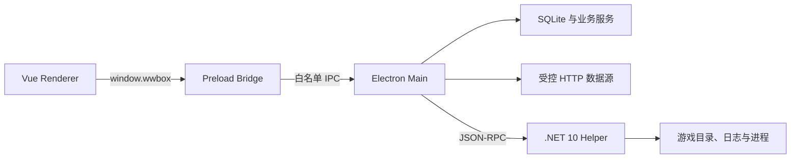

# 总体架构

## 运行结构

桌面应用使用 Electron 的 Main、Preload、Renderer 三层隔离结构。Windows 原生和游戏进程能力放在独立 .NET Helper 中，网络与数据库业务集中在 Main，Renderer 只负责交互和展示。

## 职责边界

### Renderer

- Vue 页面、组件、主题、表单和分析结果展示。
- 只调用 Preload 暴露的 `window.wwbox` 强类型 API。
- 不使用 Node.js，不直接读取文件、SQLite、注册表或启动进程。
- 只在用户明确操作需要时处理抽卡 URL、UID 等输入，不持有启动器缓存原文。

### Preload

- 通过 `contextBridge` 暴露有限方法。
- 将 Renderer 调用映射到固定 IPC Channel。
- 不暴露通用 `ipcRenderer`、Shell、文件系统或命令执行能力。

### Electron Main

- 管理窗口、单实例、应用生命周期和自启动。
- 注册 IPC Handler，并组合游戏、账号、抽卡、兑换码、库街区和版本元数据服务。
- 访问 SQLite、应用数据目录、官方启动器缓存和受控网络数据源。
- 启动、调用并监督 .NET Helper。

### .NET Helper

- 返回系统和 Helper 健康信息。
- 探测、验证游戏目录并读取版本。
- 启动、查询和结束游戏进程。
- 从受支持的游戏日志发现抽卡链接。

Helper 当前不承担普通 HTTP、SQLite、库街区或兑换码业务。新能力只有确实需要 Windows/.NET 边界时才进入 Helper。

## 主要数据流

### 游戏启动

1. Renderer 选择安装和账号并发起启动。
2. Main 校验安装记录和运行状态，激活已支持的账号缓存。
3. Main 计算通用或账号专用快捷设置并写入游戏配置。
4. Main 只传递白名单渲染参数给 Helper。
5. Helper 从已验证目录启动进程，Main 持续刷新运行状态。

### 抽卡分析

1. Main 请求 Helper 从日志发现 URL，或接收用户手动输入的 URL。
2. 抽卡服务获取各卡池记录，校验 UID、资源、时间和服务端记录 ID。
3. SQLite 仓储按 UID、卡池和记录 ID 幂等写入。
4. Main 聚合统计和版本信息，Renderer 提供直观、详情、表格与版本总结视图。

### 库街区

1. Main 从加密存储和 SQLite 读取账号配置。
2. 固定适配器请求签到、角色、资源、挑战和计算器所需数据。
3. 结果进入内存或本地缓存，Renderer 只接收展示需要的结构。
4. 自动签到和补签按账号开关调度，失败不会阻断离线模块。

## 可靠性原则

- 所有外部输入和网络响应都需要结构校验、大小限制、超时与明确错误状态。
- SQLite 写入使用稳定唯一键和迁移，不通过清空用户数据处理升级。
- 在线数据源失败不应影响已有抽卡记录、本地档案和游戏启动。
- 涉及账号缓存或游戏配置的写入必须限定目标路径和内容；扩大写入范围前先补齐备份、原子替换和恢复验证。
